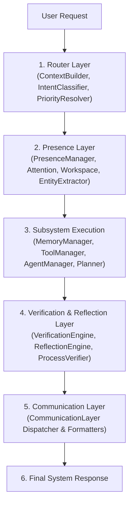

# HARIKA Cognitive Engine — Comprehensive Architecture Audit

> [!IMPORTANT]
> **Audit Status**: Complete Architecture Inspection  
> **Scope**: Router, Presence, Memory, Tools, Planning, Agents, Cognition, Vision, Voice & Communication Subsystems  
> **Directive**: Analysis & Identification of Architectural Flaws Only (Zero Code Modifications)

---

## 1. End-to-End System Pipeline Dependency Graph

---

## 2. Stage Breakdown & Decision Boundary Analysis

### Stage 1: User Request
- **Inputs**: Raw string message, user identifier (`user_id`), session context (`session_id`).
- **Outputs**: Standardized HTTP payload or websocket stream.
- **Responsibilities**: Transmission of raw user input to the Cognitive Router.
- **Decisions Belonging Here**: Client-side UI input capturing and formatting.
- **Decisions NOT Belonging Here**: Intent guessing, pre-filtering, or text manipulation.

### Stage 2: Cognitive Router
- **Inputs**: Raw text string, active agent context, conversation history.
- **Outputs**: `ActionGraph` containing prioritized `ActionNode` items, confidence score, routing policy.
- **Responsibilities**: Request context building, two-stage intent classification, confidence estimation, priority resolution.
- **Decisions Belonging Here**: Classifying intent type, determining engine priority, selecting execution policy (`AUTO`, `MEMORY_FIRST`, `TOOL_FIRST`, `CHAT_ONLY`).
- **Decisions NOT Belonging Here**: Subsystem execution, memory searching, OS process verification, string response formatting.

### Stage 3: Stateful Presence Engine
- **Inputs**: Intent type, target engine name, raw message string, subsystem executor function.
- **Outputs**: `PresenceResult` containing structured output, natural response, verification status, attention level.
- **Responsibilities**: Working memory management, attention tracking, topic inferencing, initiative calculation, coordinating execution.
- **Decisions Belonging Here**: Attention state transitions, workspace context updates, multi-turn entity tracking.
- **Decisions NOT Belonging Here**: Direct memory database querying, bypassing subsystem facades, hardcoding process verification retry logic.

### Stage 4: Subsystem Execution Facades
- **Inputs**: Parsed intent parameters, queries, target tools, goal specifications.
- **Outputs**: Structured domain data objects (`ToolResult`, `MemoryItem`, `Plan`, `AgentStatus`).
- **Responsibilities**: Executing domain operations strictly through encapsulated facade managers (`ToolManager`, `MemoryManager`, `AgentManager`, `HierarchicalPlanner`).
- **Decisions Belonging Here**: Tool invocation, persistent memory storage/recall, plan step generation, agent state machine transitions.
- **Decisions NOT Belonging Here**: Natural language formatting, conversational greetings, user presentation strings.

### Stage 5: Verification & Reflection Engine
- **Inputs**: Engine name, raw output payload, target intent, raw user message.
- **Outputs**: `VerificationResult` (overall valid, tool verified, memory verified), `ReflectionResult`.
- **Responsibilities**: Validating whether the execution output matches the user's intent and verifying OS process launch.
- **Decisions Belonging Here**: Checking OS process table (`verify_os_process`), verifying memory attribute matches.
- **Decisions NOT Belonging Here**: Re-executing tool code, overriding intent classification, generating conversational responses.

### Stage 6: Modular Communication Layer
- **Inputs**: Intent type, structured engine output, raw message string, experience decision.
- **Outputs**: Final natural language string response.
- **Responsibilities**: Formatting structured subsystem results into natural, user-facing human responses.
- **Decisions Belonging Here**: Selecting phrasing templates based on intent and structured result payloads.
- **Decisions NOT Belonging Here**: Re-running entity extraction, executing long-term memory updates (`upsert_item`), running process verifications.

---

## 3. Comprehensive Architectural Flaws & Anti-Patterns

### Flaw 1: Duplicate Routing Logic
- **Locations**:
  - `RouterManager.route_request()` ([`app/router/manager.py:48-130`](file:///d:/HARIKA/backend/app/router/manager.py#L48-L130))
  - `SubsystemResolver.execute_node()` ([`app/router/resolver.py:13-105`](file:///d:/HARIKA/backend/app/router/resolver.py#L13-L105))
  - `PresenceManager.process_directive()` ([`app/presence/manager.py:67-120`](file:///d:/HARIKA/backend/app/presence/manager.py#L67-L120))
- **Analysis**:
  - Routing decisions are made three separate times across three layers.
  - `RouterManager` resolves priority and builds an `ActionGraph`.
  - `PresenceManager.process_directive()` takes `subsystem_executor_fn` as an argument, but conditionally overrides it for `GREETING`, `SOCIAL_CONVERSATION`, `EXECUTION_FEEDBACK`, `MEMORY_QUERY`, `MEMORY_STORE`, and `CHAT` (lines 68–115), discarding the router's execution path.
  - `SubsystemResolver` maintains its own `if/elif` chain checking engine names (`ToolManager`, `MemoryManager`, `AgentManager`, `VisionManager`, `HierarchicalPlanner`, `CognitionManager`).

### Flaw 2: Duplicated Intent Classification
- **Locations**:
  - `IntentClassifier._stage1_single()` ([`app/router/classifier.py:75-220`](file:///d:/HARIKA/backend/app/router/classifier.py#L75-L220))
  - `EntityExtractor.extract_entity()` ([`app/presence/entity_extractor.py:12-85`](file:///d:/HARIKA/backend/app/presence/entity_extractor.py#L12-L85))
  - `PresenceManager.process_directive()` ([`app/presence/manager.py:56,108`](file:///d:/HARIKA/backend/app/presence/manager.py#L56-L108))
  - `CommunicationLayer` formatters ([`app/presence/communication/memory.py:8`](file:///d:/HARIKA/backend/app/presence/communication/memory.py#L8), [`tool.py:25`](file:///d:/HARIKA/backend/app/presence/communication/tool.py#L25), [`greeting.py:1`](file:///d:/HARIKA/backend/app/presence/communication/greeting.py#L1))
- **Analysis**:
  - The system classifies intent in 4 distinct places:
    1. `IntentClassifier` uses regex and keyword lists to classify into `IntentType`.
    2. `EntityExtractor` runs regex patterns 1–4 to determine if a message is a greeting, preference store, self-correction, or query.
    3. `PresenceManager` checks `if intent in ["MEMORY_QUERY", "MEMORY_STORE"] or (entity_item and intent == "CHAT")` to determine execution behavior.
    4. `CommunicationLayer` formatters re-inspect `clean.startswith("what")`, `clean.startswith("no")`, `clean.startswith("open")` to decide formatting templates.

### Flaw 3: Multiple Modules Making the Same Decision
- **Locations**:
  - **Memory Store vs Query Decision**: `IntentClassifier` (lines 180-200), `EntityExtractor` (lines 17-75), `PresenceManager` (line 108), `CommunicationLayer/memory.py` (line 8).
  - **Tool Execution Success & Process Verification**: `OpenAppTool`/`OpenWebsiteTool` (tool execution level), `SubsystemResolver` (lines 37-45), `PresenceManager` (lines 80-105 on feedback retry), `VerificationEngine` (lines 35-43), `CommunicationLayer/tool.py` (lines 114-128).
- **Analysis**:
  - No single module owns the source of truth for execution status or intent classification. Multiple layers re-evaluate raw string text or status dictionaries, causing subtle discrepancies when one layer's regex or check diverges from another's.

### Flaw 4: Error Hiding via Silent Fallbacks
- **Locations**:
  - `CommunicationLayer/chat.py` line 19: Returns `"I'm here to assist you with your request."` when engine output is empty or unhandled.
  - `SubsystemResolver.execute_node()` lines 100 & 93 ([`app/router/resolver.py`](file:///d:/HARIKA/backend/app/router/resolver.py)): Returns `{"status": "success"}` for `GREETING`, `SOCIAL_CONVERSATION`, `CAPABILITY_QUERY`, and `VisionManager` without executing subsystem code.
  - `IntentClassifier.classify_request()` line 44 ([`app/router/classifier.py`](file:///d:/HARIKA/backend/app/router/classifier.py)): Falls back to `CHAT` / `CognitionManager` at 0.50 confidence when Stage 1 and Stage 2 classification fail.
  - `MemoryStorage.load_category()` line 40 ([`app/memory/storage.py`](file:///d:/HARIKA/backend/app/memory/storage.py)): Catches JSON decode exceptions and returns `[]`, hiding disk corruption.
  - `CapabilityManager.get_all_capabilities()` lines 30 & 38 ([`app/presence/capability_manager.py`](file:///d:/HARIKA/backend/app/presence/capability_manager.py)): Catches `Exception` and swallows subsystem failures.
  - `PresenceManager.process_directive()` line 87 ([`app/presence/manager.py`](file:///d:/HARIKA/backend/app/presence/manager.py)): Catches retry exceptions during `EXECUTION_FEEDBACK` and returns dummy dictionary `{"status": "failed", "verified": False}` instead of propagating the stack trace.

### Flaw 5: Inventory of Hardcoded Responses
- **Locations**:
  - [`app/presence/communication/greeting.py`](file:///d:/HARIKA/backend/app/presence/communication/greeting.py#L1-L6):
    - `"Good morning! Ready whenever you are."`
    - `"Hi! What would you like to work on today?"`
    - `"Hello, Sahaj. Good to see you."`
  - [`app/presence/communication/social.py`](file:///d:/HARIKA/backend/app/presence/communication/social.py#L8-L23):
    - `"I'm doing well, thank you for asking!"`
    - `"I'm functioning smoothly and ready for your next directive."`
    - `"All systems operational and ready to assist."`
    - `"Not much! Ready to assist you with your tasks."`
    - `"I'm functioning smoothly and ready to help!"`
    - `"You're welcome!"`
    - `"Good night! Rest well."`
    - `"See you later."`
    - `"I'm here and ready to help!"`
  - [`app/presence/communication/memory.py`](file:///d:/HARIKA/backend/app/presence/communication/memory.py#L22-L55):
    - `"I'll remember that."`
    - `"Got it. I've updated that for you — your preference is now set to {val}."`
    - `"Your favourite {attr_name} is {val_str}."`
    - `"I remember you mentioned: {val}."`
    - `"I don't think you've told me your favourite food yet."`
    - `"I don't think you've told me your favourite drink yet."`
    - `"I don't seem to have a record of that yet."`
  - [`app/presence/communication/tool.py`](file:///d:/HARIKA/backend/app/presence/communication/tool.py#L14-L88):
    - `"I retried the action and verified {p_name} is active in OS process table{pid_str}."`
    - `"You're right. The launch wasn't successful..."`
    - `"I attempted to open {target_name}, but couldn't verify that it launched because {reason}."`
    - `"It's {hr12}:{mn} {ampm} {tz_abbr}."`
    - `"{clean_expr} = {calc_val}"`
    - `"I've opened {target_title}."`
    - `"Clipboard content: {clip_text}"`
    - `"I've taken care of it."`
  - [`app/presence/communication/planning.py`](file:///d:/HARIKA/backend/app/presence/communication/planning.py#L5-L9):
    - `"Started autonomous agent task."`
    - `"Continuing agent execution."`
    - `"Plan created successfully."`
  - [`app/presence/communication/chat.py`](file:///d:/HARIKA/backend/app/presence/communication/chat.py#L6-L20):
    - `"I noticed repeated build failures. Shall I inspect the logs...?"`
    - `"Good luck with your presentation tomorrow...!"`
    - `"Could you clarify what you'd like me to do?"`
    - `"I encountered an error processing your request."`
    - `"I'm here to assist you with your request."`

### Flaw 6: CHAT Used Incorrectly as a Fallback
- **Locations**:
  - `IntentClassifier._stage1_single()` ([`app/router/classifier.py`](file:///d:/HARIKA/backend/app/router/classifier.py)): Any message that fails deterministic stage 1 and stage 2 JSON parsing defaults to `IntentType.CHAT`.
  - `EnginePriorityResolver.resolve_priority()` ([`app/router/priority.py:22`](file:///d:/HARIKA/backend/app/router/priority.py#L22)): Defaults primary intent to `IntentType.CHAT` if no action node is prioritized.
  - `SubsystemResolver.execute_node()` ([`app/router/resolver.py:102`](file:///d:/HARIKA/backend/app/router/resolver.py#L102)): Defaults unhandled engines to `CognitionManager.process_chat()`.
  - `PresenceManager.process_directive()` ([`app/presence/manager.py:108`](file:///d:/HARIKA/backend/app/presence/manager.py#L108)): Checks `elif intent in ["MEMORY_QUERY", "MEMORY_STORE"] or (entity_item and intent == "CHAT")` to hijack `CHAT` and convert it into a memory query.

### Flaw 7: Unwarranted `success=True` Assumptions
- **Locations**:
  - `SubsystemResolver.execute_node()` line 100 ([`app/router/resolver.py`](file:///d:/HARIKA/backend/app/router/resolver.py)): Returns `{"status": "success"}` for `GREETING`, `SOCIAL_CONVERSATION`, `CAPABILITY_QUERY` without verifying underlying engine health.
  - `SubsystemResolver.execute_node()` line 93 ([`app/router/resolver.py`](file:///d:/HARIKA/backend/app/router/resolver.py)): Returns `{"status": "success", "summary": "Vision analysis ready."}` for `VisionManager` without calling any vision provider.
  - `SubsystemResolver.execute_node()` line 127 ([`app/router/resolver.py`](file:///d:/HARIKA/backend/app/router/resolver.py)): Defaults `tool_success = engine_output.get("success", True)` if the payload does not contain `success=False`.
  - `CommunicationLayer/tool.py` line 26: Defaults `tool_success = engine_output.get("success", True)` if not explicitly false.

### Flaw 8: Architectural Subsystem Bypasses
- **Locations**:
  - **Memory Bypass**: `PresenceManager.process_directive()` ([`app/presence/manager.py:109`](file:///d:/HARIKA/backend/app/presence/manager.py#L109)) BYPASSES `MemoryManager` facade and calls `memory_reasoner.rank_and_retrieve()` directly for `MEMORY_QUERY`, `MEMORY_STORE`, and `CHAT`.
  - **Communication Bypass**: `PresenceManager.process_directive()` ([`app/presence/manager.py:81-104`](file:///d:/HARIKA/backend/app/presence/manager.py#L81-L104)) BYPASSES `CommunicationLayer` formatters during `EXECUTION_FEEDBACK` process retries, directly invoking `verify_os_process`.
  - **Memory Reasoner Bypass**: `CommunicationLayer/memory.py` line 16 ([`app/presence/communication/memory.py`](file:///d:/HARIKA/backend/app/presence/communication/memory.py#L16)) BYPASSES `MemoryManager` facade and calls `memory_reasoner.check_and_resolve_contradictions()` directly.
  - **Capability Bypass**: `CapabilityManager.format_capability_summary()` ([`app/presence/capability_manager.py:44`](file:///d:/HARIKA/backend/app/presence/capability_manager.py#L44)) BYPASSES `CommunicationLayer` and generates natural text strings directly inside the manager.
  - **Classifier Bypass**: `ActionPlanner.plan_action()` ([`app/tools/planner.py:15`](file:///d:/HARIKA/backend/app/tools/planner.py#L15)) BYPASSES `IntentClassifier` and performs its own regex string matching (`"open "`, `"calculate"`, `"time"`, `"clipboard"`) to construct `ActionPlan` objects.
  - **Tool Manager Bypass**: `TaskExecutor.execute_step()` ([`app/agents/executor.py:45`](file:///d:/HARIKA/backend/app/agents/executor.py#L45)) BYPASSES `ToolManager` facade and calls `tool_registry.get_tool()` directly.
  - **Action Graph Bypass**: `HierarchicalPlanner.create_plan()` ([`app/planning/planner.py:25`](file:///d:/HARIKA/backend/app/planning/planner.py#L25)) BYPASSES `ActionGraph` and generates independent `PlanStep` objects.

---

## 4. Summary Matrix of Architectural Violations

| Flaw Category | Primary Component | Impact | Root Cause File |
| :--- | :--- | :--- | :--- |
| **Duplicate Routing** | `PresenceManager` / `SubsystemResolver` | High | [`app/presence/manager.py`](file:///d:/HARIKA/backend/app/presence/manager.py) & [`app/router/resolver.py`](file:///d:/HARIKA/backend/app/router/resolver.py) |
| **Duplicated Intent Classification** | `EntityExtractor` / `CommunicationLayer` | High | [`app/presence/entity_extractor.py`](file:///d:/HARIKA/backend/app/presence/entity_extractor.py) |
| **Duplicated Decision Making** | `VerificationEngine` / `ToolExecutor` | Medium | [`app/presence/verification.py`](file:///d:/HARIKA/backend/app/presence/verification.py) |
| **Error Hiding Fallbacks** | `CommunicationLayer` / `SubsystemResolver` | High | [`app/presence/communication/chat.py`](file:///d:/HARIKA/backend/app/presence/communication/chat.py) |
| **Hardcoded Phrasing** | Communication Submodules | Medium | [`app/presence/communication/`](file:///d:/HARIKA/backend/app/presence/communication/) |
| **Incorrect CHAT Fallback** | `IntentClassifier` / `PriorityResolver` | High | [`app/router/classifier.py`](file:///d:/HARIKA/backend/app/router/classifier.py) |
| **Unwarranted Success Assumption** | `SubsystemResolver` / `ToolFormatter` | High | [`app/router/resolver.py`](file:///d:/HARIKA/backend/app/router/resolver.py) |
| **Subsystem Bypasses** | `PresenceManager` / `ActionPlanner` / `TaskExecutor` | Critical | [`app/presence/manager.py`](file:///d:/HARIKA/backend/app/presence/manager.py) & [`app/tools/planner.py`](file:///d:/HARIKA/backend/app/tools/planner.py) |
