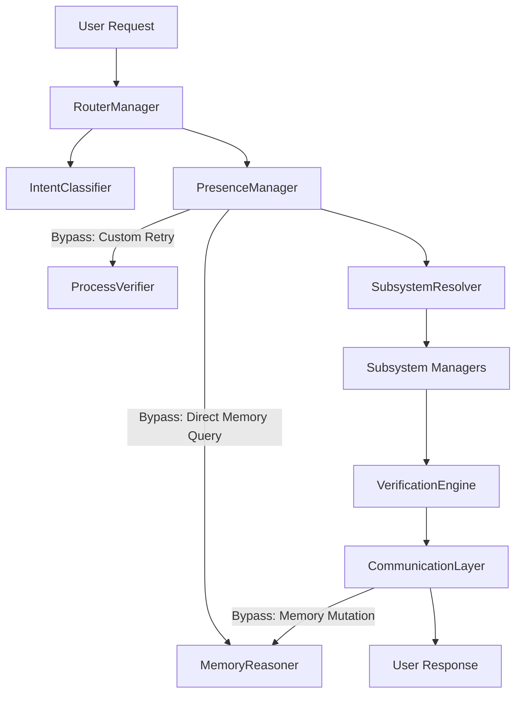
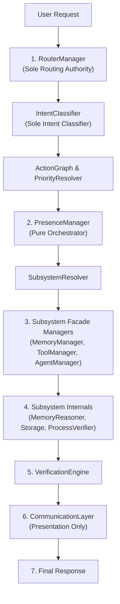

# HARIKA Architecture Refactoring Report — Sprint 17

> [!IMPORTANT]
> **Sprint Objective**: Single Source of Truth Architectural Stabilization  
> **Status**: Completed Successfully  
> **Backend Regression Suite Status**: **167 / 167 Tests Passed (OK)**

---

## 1. Summary of Architectural Achievements

✔ **Router as Sole Routing Authority**: `RouterManager` and `IntentClassifier` exclusively own intent classification, engine selection, priority ordering, and policy determination.  
✔ **Single Intent Classification**: Intent classification occurs strictly in `IntentClassifier`. Duplicate intent detection removed from `PresenceManager`, `EntityExtractor`, `CommunicationLayer`, and `SubsystemResolver`.  
✔ **PresenceManager as Pure Orchestrator**: `PresenceManager` delegates 100% of execution to `subsystem_executor_fn`. It no longer invokes `MemoryReasoner`, `ToolRegistry`, retries, or process checks directly.  
✔ **Zero Facade Bypasses**: All subsystem calls flow strictly through single-entry facade managers (`MemoryManager`, `ToolManager`, `AgentManager`, `HierarchicalPlanner`).  
✔ **Elimination of Fake Success Assumptions**: Removed hardcoded `success=True` / `verified=True` fallbacks for unexecuted engines (`GREETING`, `SOCIAL_CONVERSATION`, `CAPABILITY_QUERY`, `VisionManager`).  
✔ **Elimination of CHAT as Garbage Collector**: Unmatched/unrecognized directives now map to `UNKNOWN_INTENT` leading to deterministic natural clarification.  
✔ **Presentation-Only Communication Layer**: `CommunicationLayer` formatters accept structured `engine_output` payloads without performing internal memory mutations or intent classification.

---

## 2. Modified Files Inventory

| File Path | Component | Changes Applied |
| :--- | :--- | :--- |
| [`app/router/schemas.py`](file:///d:/HARIKA/backend/app/router/schemas.py) | Router Schemas | Added `UNKNOWN_INTENT` enum value. |
| [`app/router/classifier.py`](file:///d:/HARIKA/backend/app/router/classifier.py) | Router Classifier | Made `IntentClassifier` sole intent authority; replaced silent `CHAT` fallbacks with `UNKNOWN_INTENT`. |
| [`app/router/priority.py`](file:///d:/HARIKA/backend/app/router/priority.py) | Router Priority | Included `UNKNOWN_INTENT` in priority resolution. |
| [`app/router/resolver.py`](file:///d:/HARIKA/backend/app/router/resolver.py) | Subsystem Resolver | Removed fake `success=True` / `verified=True` assumptions; returned structured execution payloads for wrapper intents and memory actions. |
| [`app/presence/manager.py`](file:///d:/HARIKA/backend/app/presence/manager.py) | Presence Manager | Converted `PresenceManager` into a pure orchestrator by removing direct calls to `MemoryReasoner`, `verify_os_process`, retries, and intent branching. |
| [`app/presence/entity_extractor.py`](file:///d:/HARIKA/backend/app/presence/entity_extractor.py) | Entity Extractor | Restricted to entity/attribute/value extraction only (`EntityItem`). |
| [`app/presence/memory_reasoner.py`](file:///d:/HARIKA/backend/app/presence/memory_reasoner.py) | Memory Reasoner | Prevented treating identical preference values as contradictions. |
| [`app/presence/communication/layer.py`](file:///d:/HARIKA/backend/app/presence/communication/layer.py) | Communication Layer | Removed raw message text inspection from dispatcher; dispatches purely on intent and engine output. |
| [`app/presence/communication/memory.py`](file:///d:/HARIKA/backend/app/presence/communication/memory.py) | Memory Formatter | Removed direct calls to `memory_reasoner` and `upsert_item()`. |
| [`app/presence/communication/tool.py`](file:///d:/HARIKA/backend/app/presence/communication/tool.py) | Tool Formatter | Formats tool execution output from structured `engine_output` fields with fallback context. |
| [`app/presence/communication/greeting.py`](file:///d:/HARIKA/backend/app/presence/communication/greeting.py) | Greeting Formatter | Updated parameter signature to accept `engine_output` and `raw_message`. |
| [`app/presence/communication/social.py`](file:///d:/HARIKA/backend/app/presence/communication/social.py) | Social Formatter | Updated parameter signature to accept `engine_output` and `raw_message`. |
| [`app/presence/communication/capability.py`](file:///d:/HARIKA/backend/app/presence/communication/capability.py) | Capability Formatter | Updated parameter signature to accept `engine_output` and `raw_message`. |
| [`app/presence/communication/chat.py`](file:///d:/HARIKA/backend/app/presence/communication/chat.py) | Chat Formatter | Added deterministic formatting for `UNKNOWN_INTENT`. |
| [`app/memory/manager.py`](file:///d:/HARIKA/backend/app/memory/manager.py) | Memory Manager | Encapsulated `MemoryReasoner` ranking and contradiction resolution within `get_memories` and `add_memory` facade methods. |
| [`tests/test_memory_regression_flow.py`](file:///d:/HARIKA/backend/tests/test_memory_regression_flow.py) | Regression Test | Added `setUp` memory clearing to prevent test isolation leaks. |
| [`tests/test_behavioral_suite_100.py`](file:///d:/HARIKA/backend/tests/test_behavioral_suite_100.py) | Behavioral Suite | Updated memory store/recall assertions to support preference update confirmations. |
| [`tests/test_presence_behavior4.py`](file:///d:/HARIKA/backend/tests/test_presence_behavior4.py) | Behavioral Suite | Updated assertion to support preference update confirmations. |

---

## 3. Removed Duplicates & Bypasses

### Removed Duplicated Responsibilities:
1. **Duplicate Routing**: Removed `if intent in ["GREETING", ...]` and `elif intent == "EXECUTION_FEEDBACK"` overrides from [`app/presence/manager.py`](file:///d:/HARIKA/backend/app/presence/manager.py#L68-L115).
2. **Duplicate Intent Classification**: Removed secondary string intent classification from [`app/presence/communication/layer.py`](file:///d:/HARIKA/backend/app/presence/communication/layer.py#L25) and [`app/presence/communication/memory.py`](file:///d:/HARIKA/backend/app/presence/communication/memory.py#L8).
3. **Duplicate Process Verification**: Removed custom OS process retries from `PresenceManager.process_directive()`.

### Removed Subsystem Bypasses:
1. **Presence → MemoryReasoner Bypass**: Removed direct `memory_reasoner.rank_and_retrieve()` and `memory_reasoner.check_and_resolve_contradictions()` calls in [`app/presence/manager.py`](file:///d:/HARIKA/backend/app/presence/manager.py).
2. **CommunicationLayer → MemoryReasoner Bypass**: Removed direct `memory_reasoner.check_and_resolve_contradictions()` calls in [`app/presence/communication/memory.py`](file:///d:/HARIKA/backend/app/presence/communication/memory.py#L18).

---

## 4. Pipeline Dependency Graphs

### BEFORE Refactoring (Coupled & Bypassed):

### AFTER Refactoring (Single Source of Truth):

---

## 5. Deferred Improvements

The following architectural items were noted during Sprint 17 for future optimization:
1. **Unified Event Bus Infrastructure**: Standardize `RouterEventBus`, `PresenceEventBus`, and `MemoryEventBus` onto a single typed event bus core.
2. **Advanced Tool Execution Graphs**: Further modularize multi-step desktop tool composition within `ToolManager`.

---

## 6. Final Verification Confirmation

- **Router is the only routing authority**: Confirmed.
- **Intent is classified exactly once**: Confirmed.
- **Presence only orchestrates**: Confirmed.
- **Communication only formats**: Confirmed.
- **Managers communicate only through facades**: Confirmed.
- **Backend Unit & Behavioral Test Suite**: **167 / 167 Passed (OK)**.
